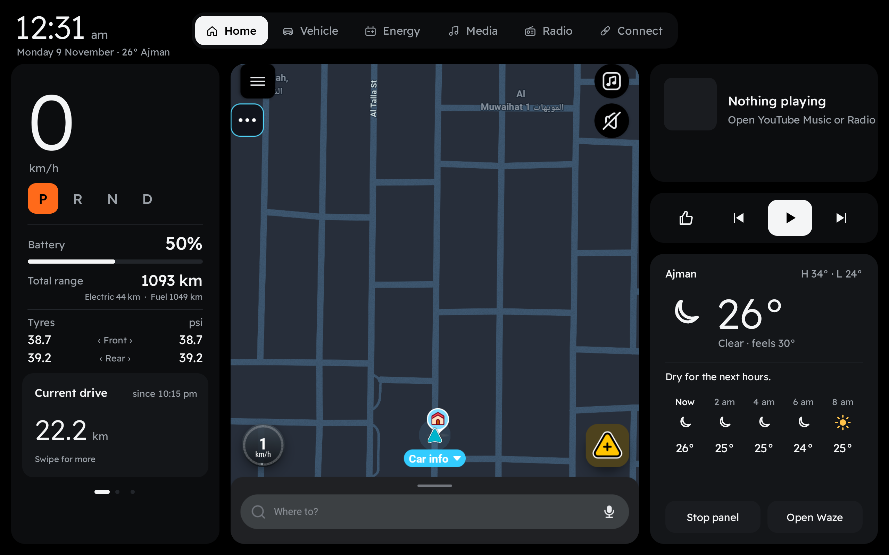
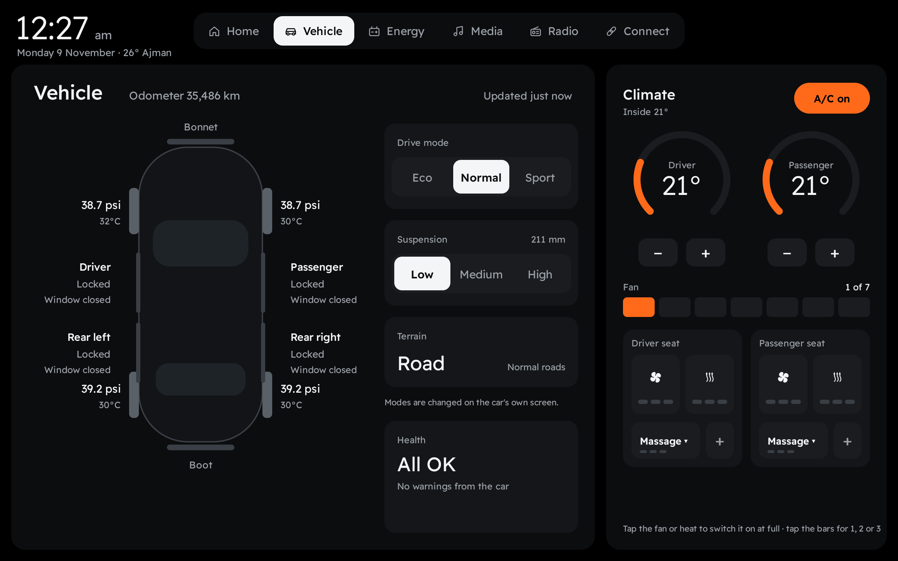
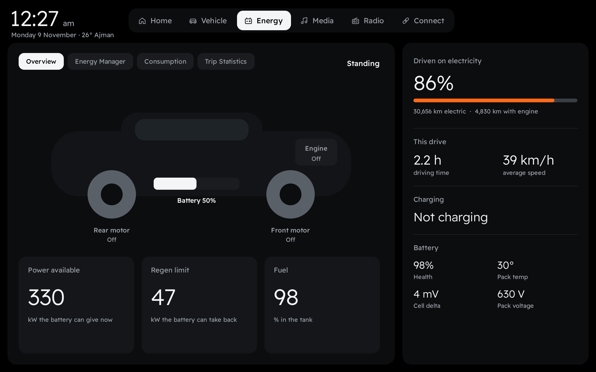
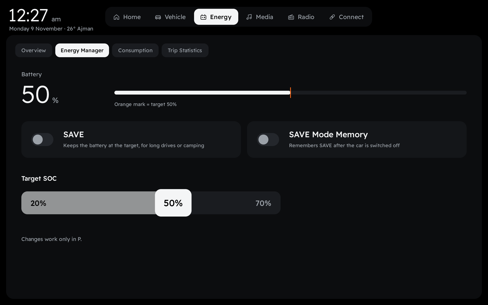
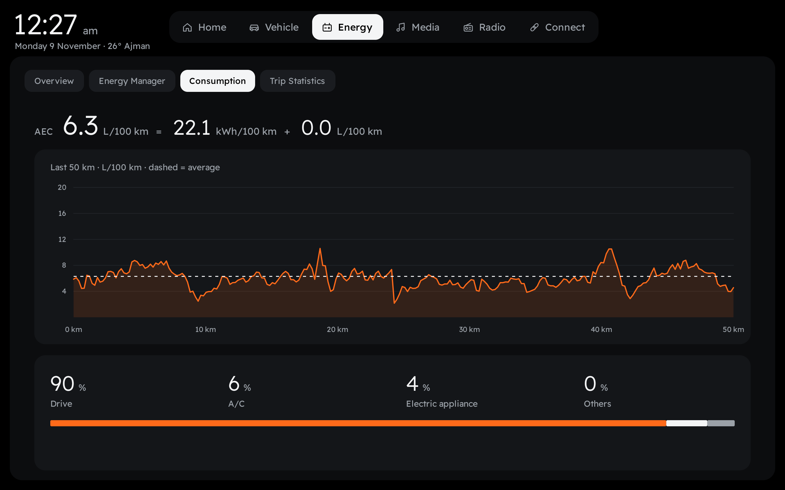
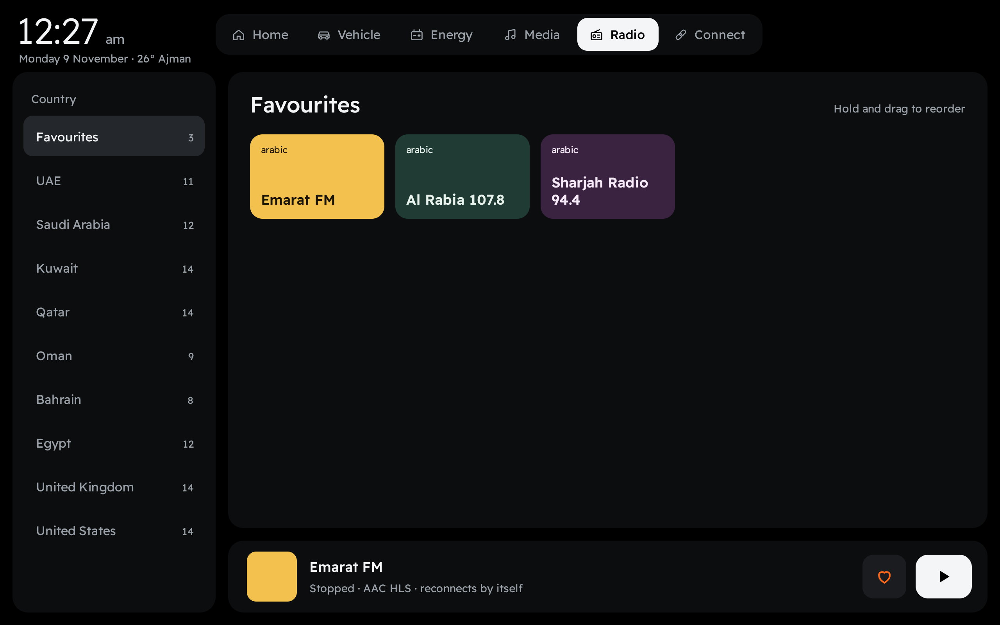
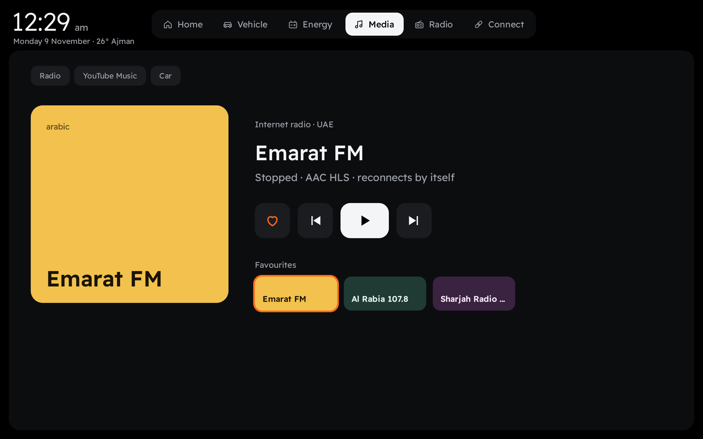
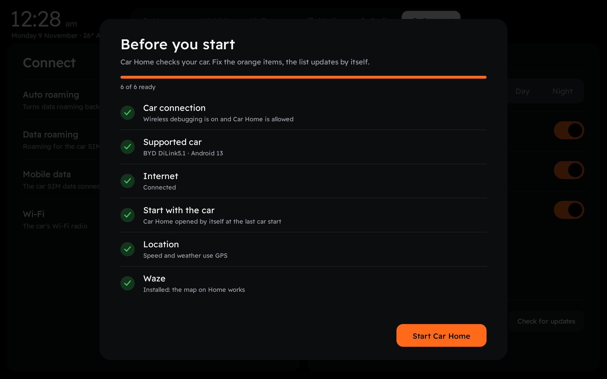

[English](README.md) · **العربية**

# Car Home

**واجهة رئيسية أوضح لسيارات بي واي دي.** السرعة، وناقل الحركة، والبطارية، والإطارات، وخريطة ويز المباشرة، والوسائط، والراديو، والطقس في شاشة واحدة، إلى جانب صفحات الطاقة والتكييف والإعدادات، مصمَّمة للاستخدام أثناء القيادة.

مجاني · بلا حساب · بلا إعلانات

## التنزيل

**[⬇ تنزيل أحدث إصدار (APK)](https://github.com/abdulla-zerehi/carhome-updates/releases/latest)**: افتح صفحة الإصدار ونزّل الملف `CarHome-x.x.apk`.

بعد التثبيت الأول يُحدِّث Car Home نفسه تلقائيًا، إذ يظهر زر **Update** برتقالي في أعلى يمين الشاشة عند صدور إصدار جديد.

📖 الدليل: **[PDF](guide/CarHome-Guide.pdf)** · **[فيديو](guide/CarHome-Guide.mp4)**

💬 الأسئلة والأخبار: **[تلغرام t.me/carhomeapp](https://t.me/carhomeapp)**

## المزايا

| | |
|---|---|
| **الرئيسية** | السرعة، ووضع ناقل الحركة (P R N D)، والبطارية والمدى الكلي، وضغط الإطارات، وعدّادات الرحلات، وخريطة ويز المباشرة، وما يُشغَّل الآن، والطقس |
| **السيارة** | الأبواب والنوافذ وغطاء المحرك والصندوق، وضغط الإطارات وحرارتها، ووضع القيادة، والتعليق، وحالة السيارة، والتكييف والمقاعد |
| **الطاقة** | نظرة عامة على المحركات · مدير الطاقة (SAVE، وذاكرة SAVE، والنسبة المستهدفة من 20 إلى 70%) · استهلاك آخر 50 كم · إحصائيات الرحلات اليومية |
| **الوسائط** | تتبع ما يُشغَّل: الراديو، أو يوتيوب ميوزك، أو مشغّل السيارة |
| **الراديو** | محطات مُختبَرة من الإمارات والخليج ومصر وبريطانيا وأمريكا · مفضلة يمكن ترتيبها بالسحب · أزرار التالي والسابق على المقود |
| **الاتصال** | التجوال، وبيانات الجوال، والواي فاي، والمظهر النهاري والليلي، واللغة (العربية / English)، والفتح مع تشغيل السيارة، وتقارير المشكلات، ومجموعة تلغرام، ورقم الإصدار وفحص التحديثات |

 
 
 

## المتطلبات

- سيارة بي واي دي بنظام DiLink. **جرى الاختبار على DiLink 5.1 (أندرويد 13).** قد تعمل الطرازات والشاشات الأخرى، ونرجو إبلاغنا بالنتيجة.
- تفعيل خيارات المطوّر و**تصحيح الأخطاء اللاسلكي (Wireless debugging)**. يستخدمه Car Home لقراءة بيانات السيارة داخل السيارة نفسها، ولا يخرج منها شيء.
- اتصال بالإنترنت للطقس والراديو والتحديثات.
- تطبيق ويز (اختياري) لعرض الخريطة في الصفحة الرئيسية.

## التثبيت

1. **انقل ملف APK إلى السيارة** بإحدى الطرق التالية:
   - **متصفح السيارة:** افتح هذه الصفحة على شاشة السيارة ونزّل الملف.
   - **ذاكرة USB:** انسخ الملف إليها، ثم صِلها بالسيارة وافتحه من مدير الملفات.
   - **الحاسوب:** باستخدام adb نفّذ الأمر `adb install CarHome-x.x.apk`.
2. **فعّل تصحيح الأخطاء اللاسلكي** من خيارات المطوّر في السيارة.
3. **افتح Car Home.** تفحص شاشة **Before you start** كل شيء وتوضّح لك ما يحتاج إلى إصلاح. وعند ظهور نافذة تصحيح الأخطاء اختر **Always allow**.
4. ليفتح Car Home مع تشغيل السيارة، اسمح له في **إدارة تشغيل التطبيقات (App start management)** واسمح له بالعمل في الخلفية.

## السلامة

- يمكن تشغيل **SAVE** أو إيقافه أثناء القيادة، كما في مدير الطاقة الأصلي في السيارة. أما باقي التغييرات على السيارة (ذاكرة SAVE، والنسبة المستهدفة، والتكييف) فلا تعمل إلا والسيارة على وضع الوقوف **P**.
- لا تُثبَّت التحديثات إلا على وضع **P**، وفقط إذا كان الملف موقَّعًا منا، وتُرفض أي نسخة معدَّلة.
- أبقِ عينيك على الطريق. Car Home واجهة عرض، وتبقى أنظمة السيارة الأصلية هي المسؤولة.

## الخصوصية

لا يتطلب Car Home أي حساب ولا يجمع أي بيانات شخصية. تُقرأ بيانات السيارة وتُعرض داخل السيارة فقط. ويُرسَل أمران فقط:

- **عدّاد مجهول الهوية** (تنزيل ملف صغير جدًا عند التثبيت ومرة يوميًا) لمعرفة عدد السيارات المستخدمة.
- **تقارير المشكلات** (ابتداءً من الإصدار 1.5) لنُصلح المشكلات دون أن تحتاج إلى إخبارنا: عند توقف التطبيق المفاجئ، أو تعذّر الاتصال بالسيارة أو إكمال الإعداد، أو فشل التحديث، ومرة واحدة لكل إصدار فحص قصير لحالة التطبيق. يتضمن التقرير طراز السيارة، وإصدار أندرويد، وحجم الشاشة، وإصدار التطبيق، وخطوات الإعداد التي تعمل، والخطأ، وآخر أسطر السجل التقني للتطبيق. ولا يتضمن **أي اسم أو موقع أو رسائل أو موسيقى**، بل رقمًا عشوائيًا يُنشأ عند التثبيت لتجميع تقارير السيارة نفسها.

تُشفَّر التقارير **داخل السيارة** (RSA وAES-256) قبل خروجها منها، ولا يستطيع قراءتها إلا خادمنا. ويمكنك إيقافها في أي وقت من: **الاتصال › إرسال تقارير المشكلات**.

## أسئلة شائعة

**هل التطبيق مجاني فعلًا؟** نعم.
**هل يغيّر شيئًا في سيارتي؟** فقط عندما تضغط بنفسك على أحد إعدادات السيارة، وعلى وضع P فقط. وتبقى الإعدادات التي غيّرتها كما هي، ولا يُلغيها حذف التطبيق.
**الخريطة سوداء.** اضغط *Stop panel* ثم اضغط على الخريطة مرة أخرى.
**طراز سيارتي غير مذكور.** جرّبه، وأخبرنا بالطراز وإصدار DiLink عبر [تلغرام](https://t.me/carhomeapp) أو في بلاغ (Issue).

---

© 2026 Abdulla Zerehi. جميع الحقوق محفوظة. التنزيل والاستخدام مجانيان. لا يُسمح بنسخ هذا البرنامج أو تعديله أو إعادة توزيعه أو تفكيكه أو الهندسة العكسية له. لا يرتبط التطبيق بشركة بي واي دي أو ويز، والأسماء ملك لأصحابها.

