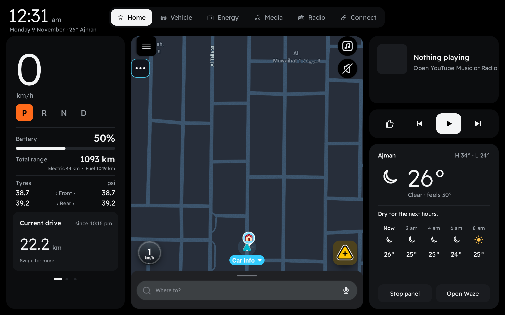
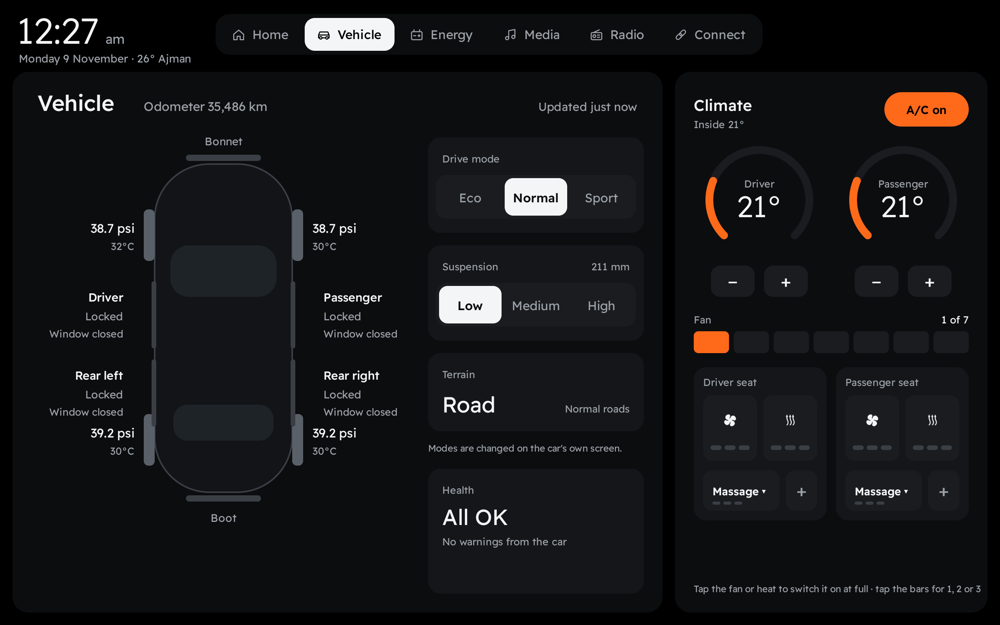
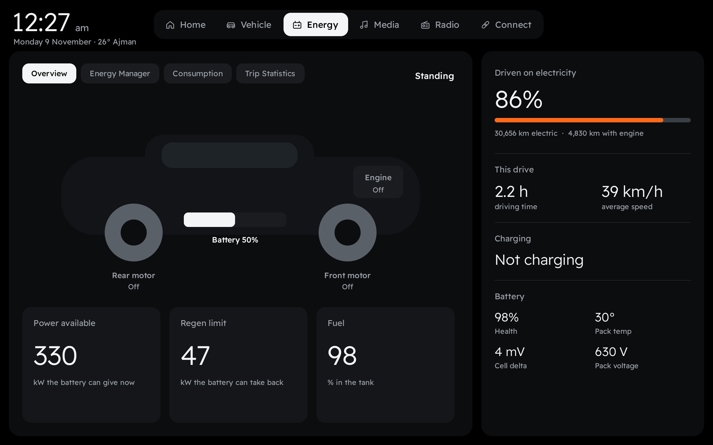
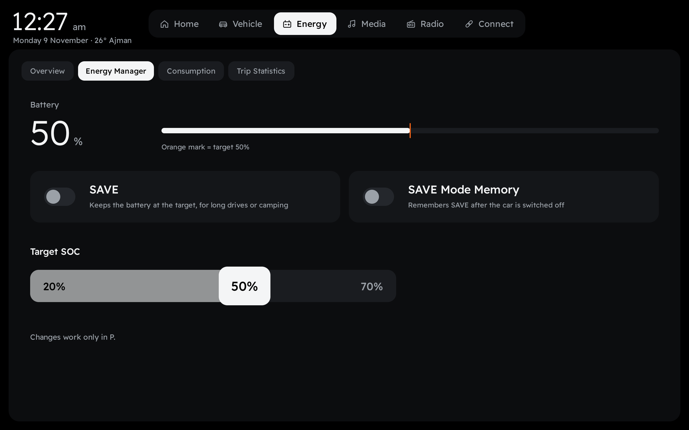
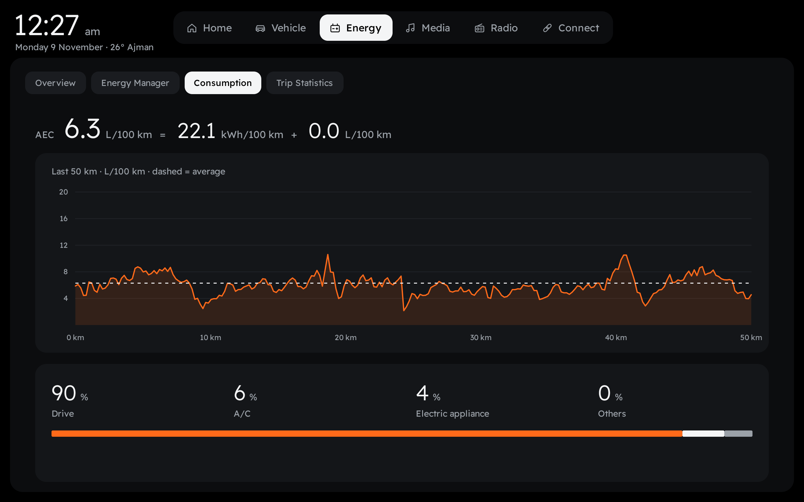
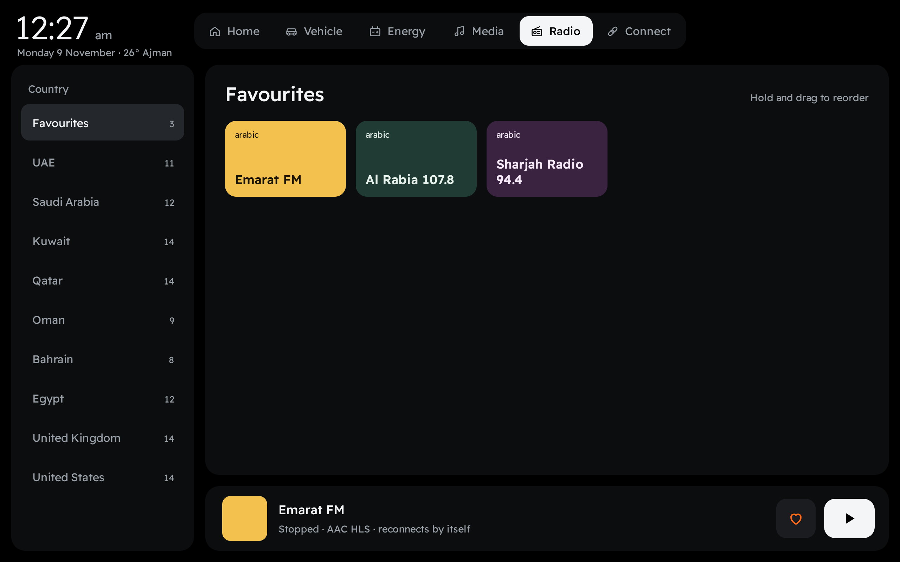
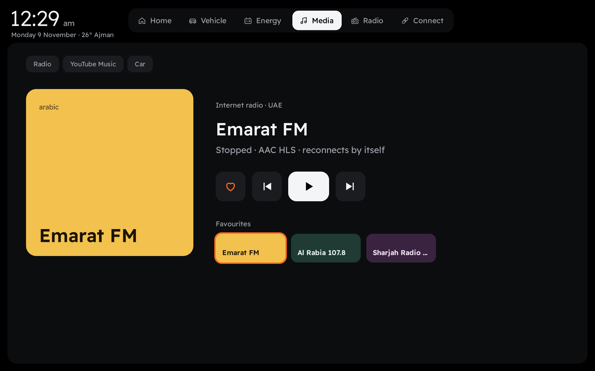
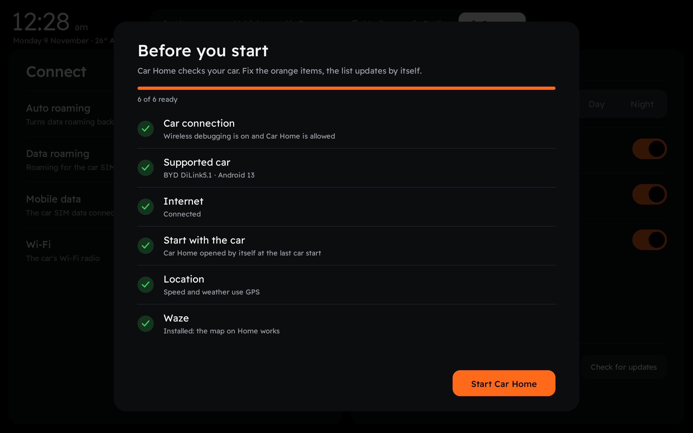

**English** · [العربية](README.ar.md)

# Car Home

**A cleaner home screen for BYD cars.** Speed, gear, battery, tyres, live Waze map, media, radio and weather on one screen — plus the car's energy pages, climate and settings, designed for driving.

Free · No account · No ads

## Download

**[⬇ Download the latest version (APK)](https://github.com/abdulla-zerehi/carhome-updates/releases/latest)** — open the release and download `CarHome-x.x.apk`.

After the first install, Car Home updates itself: an orange **Update** button appears at the top right when a new version is out.

📖 Guide: **[PDF](guide/CarHome-Guide.pdf)** · **[Video](guide/CarHome-Guide.mp4)** (Arabic)

💬 Questions and news: **[Telegram t.me/carhomeapp](https://t.me/carhomeapp)**

## What it does

| | |
|---|---|
| **Home** | Speed, gear (P R N D), battery and total range, tyre pressures, trip counters, live Waze map, now playing, weather |
| **Vehicle** | Doors, windows, bonnet and boot, tyre pressure and temperature, drive mode, suspension, health, climate and seats |
| **Energy** | Overview of motors and engine · Energy Manager (SAVE, SAVE memory, target SOC 20–70%) · consumption of the last 50 km · daily trip statistics |
| **Media** | Follows what is playing: radio, YouTube Music or the car's player |
| **Radio** | Tested internet stations from the UAE, Gulf, Egypt, UK and US · favourites you can reorder by dragging · steering wheel next / previous |
| **Connect** | Data roaming, mobile data, Wi-Fi, day / night look, language (English / العربية), open on start, problem reports, Telegram group, version and update check |

 
 
 

## Requirements

- A BYD car with DiLink. **Tested on DiLink 5.1 (Android 13).** Other models and screen sizes may work — please report how it goes.
- Developer options with **Wireless debugging** on. Car Home uses it to read the car's data on the car itself; nothing leaves the car.
- Internet for weather, radio and updates.
- Waze (optional) for the map on Home.

## Install

1. **Get the APK onto the car** — any one of these:
   - **Car browser:** open this page on the car's screen and download the APK.
   - **USB stick:** copy the APK to a USB stick, plug it in and open it from the car's file manager.
   - **Computer:** with adb, run `adb install CarHome-x.x.apk`.
2. **Turn on Wireless debugging** in the car's Developer options.
3. **Open Car Home.** The **Before you start** screen checks everything and tells you what to fix. When the debugging popup appears, choose **Always allow**.
4. For Car Home to open with the car, allow it in **App start management** and allow it to run in the background.

## Safety

- Changes to the car (SAVE, target SOC, climate) only work while the car is in **P**.
- Updates install only in **P**, and only if the file is signed by us — a changed copy is refused.
- Keep your eyes on the road. Car Home is a display; the car's own systems stay in charge.

## Privacy

Car Home has no account and collects no personal data. Car data is read and shown on the car only. Two things are sent out:

- **An anonymous count** (one tiny file download per install and per day) so we know how many cars use it.
- **Problem reports** (from version 1.5) so we can fix problems without you having to tell us: when the app crashes, when the car connection or setup does not work, when an update fails, and once per version a short health check. A report holds the car model, Android version, screen size, app version, which setup steps work, the error and the last lines of the app's technical log. It holds **no name, no location, no messages and no music**, only a random number made on install so reports from the same car can be grouped.

Reports are **encrypted on the car** (RSA + AES-256) before they leave it, and only our server can read them. Turn them off any time: **Connect › Send problem reports**.

## Questions

**Is it really free?** Yes.
**Does it change my car?** Only when you press a car setting yourself, and only in P. Settings you changed stay as you set them; uninstalling the app does not undo them.
**The map is black.** Press *Stop panel*, then tap the map again.
**My model is not listed.** Try it and tell us your model and DiLink version on [Telegram](https://t.me/carhomeapp) or in an issue.

---

© 2026 Abdulla Zerehi. All rights reserved. Free to download and use. No permission is granted to copy, modify, redistribute, decompile or reverse engineer this software. Not affiliated with BYD or Waze; names belong to their owners.
